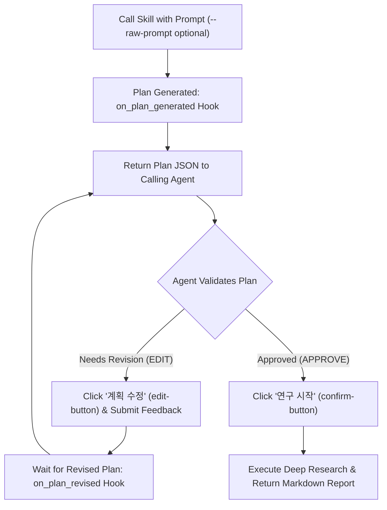

# Local Gemini App Deep Research Skill

This skill automates the locally installed **Google Gemini Windows Desktop App** (`%LOCALAPPDATA%\Google\Gemini\app-*\Gemini.exe`) via Chrome DevTools Protocol (CDP) and Playwright to execute **Gemini Deep Research** using the user's logged-in Google account without requiring an API key.

## Architecture & How It Works

1. **Automatic CDP Enablement ([patch_gemini_app.py](./scripts/patch_gemini_app.py))**:
   - Locates the latest installed `%LOCALAPPDATA%\Google\Gemini\app-*\resources\app.asar`.
   - Creates a safe backup (`app.asar.bak`) and patches `src/main.js` (preserving exact byte length and SHA256 header integrity) to enable `--remote-debugging-port=9222` and `--disable-renderer-backgrounding`.
   - Launches `Gemini.exe --hide` persistently in the background via WMI (`Win32_Process.Create`) so the window stays hidden and does not steal focus.
2. **Deep Research Execution & Plan Verification Loop ([run_deep_research.py](./scripts/run_deep_research.py))**:
   - Connects to `http://127.0.0.1:9222` using Playwright (`connect_over_cdp`).
   - Opens a new chat (`https://gemini.google.com/app`), ensures **Pro** (`3.8 Pro`, instead of `Argon`) mode is selected (`[data-test-id="bard-mode-menu-button"]`), and enables **Deep Research** (`업로드 및 도구` → `도구 더보기` → `Deep Research`).
   - Submits the prompt using native keyboard input events (`keyboard.insert_text`) — either **verbatim as passed at invocation time (`--raw-prompt`)** or as crafted by the calling agent.
   - Waits for the **Research Plan (`[data-test-id="research-steps"]`)**, cancels any auto-start countdown timer (`[data-test-id="cancel-fuse-button"]`), and expands all `"더보기"` sections to extract the full plan text.
   - **Plan Review Hook & Iterative Modification Loop** (optional):
     - Triggers the `on_plan_generated` hook and returns the full plan JSON to the calling agent.
     - The calling agent verifies the plan and either requests modifications (`EDIT: <instructions>` / `--step edit`) or approves (`APPROVE` / `--step approve`).
     - On edit, clicks **`계획 수정` (`[data-test-id="edit-button"]`)**, submits the modification instructions, waits for the revised plan (`on_plan_revised`), and returns the revised plan to the calling agent again in a loop until approved.
   - Once approved (or immediately if plan review is disabled), clicks **`연구 시작` (`[data-test-id="confirm-button"]`)**.
   - Monitors live research thoughts (`[data-test-id="thought-header"]` / `[data-test-id="thought-body"]`) until `immersive-entry-chip gem-processing-card.completed` indicates completion.
   - Extracts the pure report body from `deep-research-immersive-panel message-content` (`[data-test-id="message-content"]`) and citation links into GitHub-Flavored Markdown.

---

## Prompt & Plan Review Options

| Option | Behavior |
| :--- | :--- |
| `--raw-prompt` | **Exact Prompt Preservation**: Enters the exact prompt string provided at invocation time without any agent rewriting, expansion, or modification. When the user or calling agent requests exact prompt execution, **DO NOT alter the prompt text** and pass `--raw-prompt`. |
| `--review-plan` | **Interactive Stdin Plan Review Hook Loop**: Pauses when the plan is generated, emits `[PLAN_REVIEW_HOOK_START] ... [PLAN_REVIEW_HOOK_END]`, and waits on stdin for the calling agent to send `EDIT: <modification instructions>` (loops until satisfied) or `APPROVE` (starts research). |
| `--step plan \| edit \| approve` | **Step-by-Step Agent Loop Control**: Stateless CLI commands for calling agents to generate a plan (`--step plan`), iteratively modify and re-verify the plan (`--step edit --edit-prompt "..."`), and finally approve and execute Deep Research (`--step approve`). |
| `--plan-hook <cmd>` | **External Hook Script Loop**: Executes `<cmd>` whenever a plan is generated/revised, passing the plan JSON on `stdin` and reading `APPROVE` or `EDIT: <instructions>` from `stdout`. |

---

## Usage Workflows for the Calling Agent

### Workflow A: Iterative Plan Review & Modification Loop (Agent-Verified Plan)

Use this workflow when the calling agent (or user) should inspect and iteratively refine the generated Deep Research plan before starting the 5–15 minute research execution.



#### Method 1: Step-by-Step CLI Loop (Recommended for Calling Agents)

1. **Step 1 — Generate Initial Plan (`--step plan`)**:
   ```powershell
   [Console]::OutputEncoding = [System.Text.Encoding]::UTF8
   $env:PYTHONIOENCODING = "utf-8"
   python "$HOME\.gemini\config\skills\local-gemini-deep-research\scripts\run_deep_research.py" `
     --raw-prompt `
     --step plan `
     --prompt "<PROMPT>"
   ```
   - Reads the emitted `[PLAN_REVIEW_HOOK_START] ... [PLAN_REVIEW_HOOK_END]` JSON (`plan_text`, `iteration`, `url`).

2. **Step 2 — Verify & Iteratively Modify Plan (`--step edit`, repeat as needed)**:
   - Inspect `plan_text`. If any required subtopics, methodology, or constraints are missing, call `--step edit` with modification instructions:
   ```powershell
   [Console]::OutputEncoding = [System.Text.Encoding]::UTF8
   $env:PYTHONIOENCODING = "utf-8"
   python "$HOME\.gemini\config\skills\local-gemini-deep-research\scripts\run_deep_research.py" `
     --step edit `
     --resume-url "current" `
     --edit-prompt "<MODIFICATION_INSTRUCTIONS>"
   ```
   - This clicks **`계획 수정` (`[data-test-id="edit-button"]`)**, submits `<MODIFICATION_INSTRUCTIONS>`, waits for the newly generated plan card, and returns the revised plan JSON (`hook_event: "on_plan_revised"`).
   - Repeat **Step 2** as many times as needed until the revised plan passes verification.

3. **Step 3 — Approve Plan & Execute Deep Research (`--step approve`)**:
   - Once the plan is verified and approved, exit the loop and start the research:
   ```powershell
   [Console]::OutputEncoding = [System.Text.Encoding]::UTF8
   $env:PYTHONIOENCODING = "utf-8"
   python "$HOME\.gemini\config\skills\local-gemini-deep-research\scripts\run_deep_research.py" `
     --step approve `
     --resume-url "current" `
     --output "<OUTPUT_MARKDOWN_FILE_PATH>"
   ```

#### Method 2: Single-Process Interactive Hook Loop (`--review-plan`)

1. Launch `run_deep_research.py` with `--review-plan` (and `--raw-prompt` if preserving exact prompt):
   ```powershell
   [Console]::OutputEncoding = [System.Text.Encoding]::UTF8
   $env:PYTHONIOENCODING = "utf-8"
   python "$HOME\.gemini\config\skills\local-gemini-deep-research\scripts\run_deep_research.py" `
     --raw-prompt `
     --review-plan `
     --prompt "<PROMPT>" `
     --output "<OUTPUT_MARKDOWN_FILE_PATH>"
   ```
2. Check task output when `[PLAN_REVIEW_HOOK_WAITING_FOR_INPUT]` appears:
   - To **modify the plan**, send input to the running task via `manage_task(Action="send_input", TaskId="...", Input="EDIT: <수정할 계획 내용>\n")`. Wait for the next `on_plan_revised` payload and re-verify.
   - To **approve the plan**, send `manage_task(Action="send_input", TaskId="...", Input="APPROVE\n")`. The loop terminates, clicks **`연구 시작`**, and runs Deep Research to completion.

---

### Workflow B: Automatic End-to-End Execution (No Plan Review Loop)

When immediate execution without plan review is desired:

```powershell
[Console]::OutputEncoding = [System.Text.Encoding]::UTF8
$env:PYTHONIOENCODING = "utf-8"
python "$HOME\.gemini\config\skills\local-gemini-deep-research\scripts\run_deep_research.py" `
  --raw-prompt `
  --prompt "<PROMPT>" `
  --output "<OUTPUT_MARKDOWN_FILE_PATH>"
```

* Omit `--raw-prompt` if the calling agent was asked to expand/enrich a brief user topic into a comprehensive research prompt.
* **Prompt Guidelines**: Avoid sensitive political/election keywords (e.g., `민주주의`, `선거`, `정치`) in Korean prompts when possible, as Gemini Web's Korean content filter may block plan generation.
* When `run_command` backgrounds the task, **do not poll in a loop**. End your turn and wait for the system notification when the background task finishes.

---

### Troubleshooting & Maintenance

* **Check / Start Local Gemini App with CDP only**:
  ```powershell
  python "$HOME\.gemini\config\skills\local-gemini-deep-research\scripts\patch_gemini_app.py"
  ```
* **Show the Local Gemini App Window** (if the user wants to watch visually or re-authenticate):
  Add `--show` to either `patch_gemini_app.py` or `run_deep_research.py`.
* **Restore Original Unpatched `app.asar`**:
  ```powershell
  python "$HOME\.gemini\config\skills\local-gemini-deep-research\scripts\patch_gemini_app.py" --restore
  ```

---

## Relay Mode — Caller-Managed Plan Review (`scripts/relay_step.py`)

Who reviews the research plan depends on **who started the agent that runs this skill**:

| Invoked by | Plan reviewer | How |
| :--- | :--- | :--- |
| A user talking to the agy agent directly | the agy agent (Workflow A above) | `--step plan` / `--step edit` / `--step approve`, or `--review-plan` |
| Another agent that owns the plan — e.g. the Claude Code skill **`agy-deep-research`**, which calls `agy` headlessly | **the caller** (Claude) | relay mode: the agy agent runs one step per turn and hands the result file back |

In relay mode the agy agent is the **operator**, not the reviewer. The caller signals relay mode with a task that
names a job directory holding `relay/request.json`. Then:

1. Run `python <this skill>/scripts/relay_step.py --job <job dir>` exactly as the task states (the task may point at
   an equivalent copy of the relay bundled with the caller). It executes one `run_deep_research.py --step plan|edit|approve|auto`
   command — `request.json` says which, with the prompt / feedback / resume-URL files — captures the driver's stdout
   and stderr under `<job>/relay/`, parses the `[PLAN_REVIEW_HOOK_*]` payload or the report, and writes
   `<job>/relay/result.json` (or `started.json`, see below).
2. Read the result file and report its `status`, `code`, `url`, `plan_count` / `report_chars` in your summary. The plan
   text is in the file; never retype it and never paraphrase it.
3. On `status: "error"` with `CDP_NOT_READY` / `CDP_CONNECT_FAILED` and `prompt_sent: false` you may run
   `patch_gemini_app.py` once and run the relay once more. The relay never acts twice for one request: a re-run after
   the prompt or feedback reached the conversation is refused as `STEP_ALREADY_ACTED`, and a page timeout after the
   prompt went in is `PAGE_TIMEOUT_AFTER_SEND` (not an environment code). `GEMINI_PAGE_NOT_FOUND` /
   `UI_SELECTOR_TIMEOUT` usually mean the app is not signed in: report them (never sign in yourself; a hidden running
   app cannot be shown by the launcher, the caller restarts it visibly for the user). Any other code is reported,
   not retried or worked around.
4. Do not craft or alter the prompt; do not review, modify or approve the plan; do not answer a plan review
   (`APPROVE` / `EDIT:`) yourself; never invoke `run_deep_research.py` yourself (the relay is the only thing that runs
   it); do not touch `request.json`, `prompt.md`, `goal.md`, `feedback_*.md`, `result.json` or `started.json`. The
   caller makes every plan decision between steps and writes the next `request.json`.

Relay steps map to the step-by-step CLI loop: `plan` → `edit`* → `approve`. Two more exist for the caller's recovery
and no-review paths:

- `collect` re-attaches to a research that is running or finished. It **never starts one**: the relay first probes the
  page read-only (through the driver's Python and playwright, navigating to the conversation if the tab is elsewhere)
  and refuses with `COLLECT_WOULD_START` when the plan card still has an active "연구 시작" button; only then does it run
  `--step approve`, which without an active button falls through to the report wait. Should a click still happen (a
  card rendered in between) the result is `COLLECT_STARTED_RESEARCH`, not `completed`.
- `approve` probes first too: no active start button → `CONFIRM_MISSING` without running the driver; a different
  conversation or plan-card count than the caller reviewed (`expected_url`, `expected_plan_count`) → `PLAN_CHANGED`.
  `edit` probes only to settle the tab on the conversation before the driver runs.
- `auto` is the caller's explicit no-review mode (`--step auto`); the relay records the conversation URL afterwards.
- `probe` only runs the read-only page probe (`active_confirm`, `active_edit`, `plan_cards`, `report_len`, `url`).
- When the probe itself fails (CDP down, playwright missing) `collect` refuses with `COLLECT_PROBE_FAILED` unless the
  request carries `allow_probe_error` (the caller sets it only when an approve is on record).

For `approve` / `collect` / `auto` the request usually sets `mode: "detach"`: the relay then starts a detached worker
(through WMI, the way `Gemini.exe` is launched) and returns `status: "started"` with the worker's pid in
`relay/started.json`; `result.json` appears when the research is done. `started` is the expected successful result of
that turn — do not wait for the research, do not look for `result.json`, and do not run the relay again (a second run
for the same request returns the existing `started.json` instead of starting another worker). The plan step retries
once on its own when the Tools menu fails to open right after a new chat (`retried: true` in the result).

`request.json` fields: `step`, `driver` (path of `run_deep_research.py`), `prompt_file`, `feedback_file`, `resume_url`,
`output`, `timeout`, `deadline`, `mode`, `show`, `allow_missing_confirm`, `seq`, `python`, `env`, `cdp_url`.
`result.json` fields: `status` (`plan_ready` | `plan_revised` | `completed` | `started` | `probed` | `error`), `code`,
`message`, `hint`, `rc`, `event`, `url`, `plan`, `plan_count`, `edit_button_clicked`, `confirm_clicked`, `prompt_sent`,
`app_status`, `navigated`, `retried`, `probe`, `report_file`, `report_chars`, `sources_count`, `elapsed_s`,
`stdout_log`, `stderr_log`, `pid`, `launcher`, `seq`.
