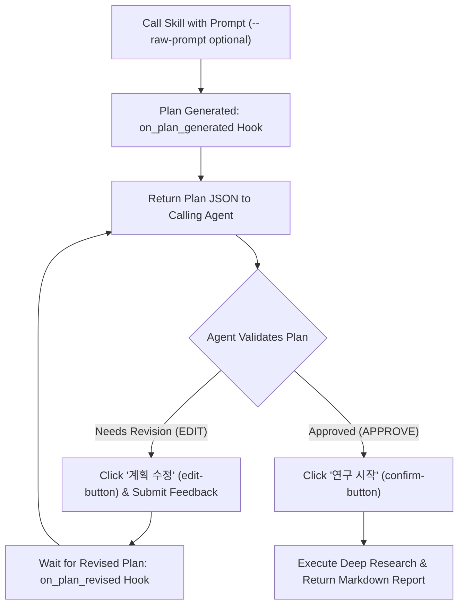

# Local Gemini App Deep Research Skill

This skill automates the locally installed **Google Gemini Windows Desktop App** (`%LOCALAPPDATA%\Google\Gemini\app-*\Gemini.exe`) via Chrome DevTools Protocol (CDP port 9223) and Playwright to execute **Gemini Deep Research** using the user's logged-in Google account without requiring an API key.

## Compatibility & Prerequisites

- **Supported Operating Systems**: Windows 11 / Windows 10 (x64).
- **Google Gemini Desktop App**: Version **v1.18.0+** (patch verified on v1.19.0; tested on Electron 44.6.0+, Chromium 152.0.7977.130+). Installed at `%LOCALAPPDATA%\Google\Gemini\app-*\Gemini.exe`.
- **Python Runtime**: Python 3.10+ (tested on Python 3.12).
- **Runtime Dependency**: `playwright` must be installed:
  ```powershell
  python -m pip install --user playwright
  ```
  *(Note: Playwright's browser binaries are not required; only the Python client library is needed to connect over CDP).*
- **Google Account Authentication**: The user must be signed in to their Google account in the Gemini desktop app. The automation inherits the user's logged-in session, active Gemini Advanced / Google AI Pro subscription, and connected Google Workspace connectors (Google Drive, Gmail, Docs) without requiring external API keys.

---

## Architecture & How It Works

### 1. Dynamic ASAR Security Argument Patcher ([patch_gemini_app.py](./scripts/patch_gemini_app.py))
- **Electron Security Bypass**: Packaged Electron applications enforce strict argument validation (`app.isPackaged`) and abort execution if unauthorized command-line switches like `--remote-debugging-port` are detected:
  ```javascript
  var Pg=wg(h.app.isPackaged&&P!=="dev",process.argv,process.execArgv);
  Pg?(c.error("security",_g,`(switch: --${Pg})`),Dt(),h.app.exit(1)):Rb();
  ```
- **Dynamic Minification Regex**: `patch_gemini_app.py` uses a flexible regex pattern `(?:[\w$]+)\.error("security", ...)` (`SECURITY_GUARD_RE`; every identifier is `[\w$]+` because minified names may contain `$`, e.g. `$m` in v1.19.0) that accommodates minified logger names across Electron releases (`c.error` in v1.18.0+, `u.error` in earlier releases) while dynamically resolving the application instance variable (e.g., `h`) and continuation function (e.g., `Rb`).
- **Byte-Length Parity Preservation**: Electron ASAR archive headers rely on precise 64-bit byte offsets. Rather than altering file offsets (which would corrupt the ASAR index), the patch replaces the exit call with:
  ```javascript
  h.app.commandLine.appendSwitch("remote-debugging-port","9223");h.app.commandLine.appendSwitch("disable-renderer-backgrounding");Rb();/*    */
  ```
  Trailing comment padding (`/* ... */`) ensures that the replacement string matches the exact character count and byte length of the original target block.
- **Backup & Rollback**: Automatically creates `app.asar.bak` prior to modification. Supports `--dry-run`, `--check`, and `--restore` operations.

### 2. WMI Detached Process Launcher & Background Throttling Bypass
- **Non-Focus-Stealing Hidden Execution**: Launches `Gemini.exe --hide` via WMI `Win32_Process.Create`. The application process runs detached in the background without stealing window focus, showing a taskbar window, or interrupting user workflows.
- **Port 9223 Standardization**: Unified default CDP port `9223` (`http://127.0.0.1:9223`) prevents collisions with default Chrome debugging sessions.
- **Background Throttling Bypass**: Chromium normally throttles timers and CPU budgets in background windows. The combination of command-line switch `--disable-renderer-backgrounding` and CDP protocol commands `Page.setWebLifecycleState(state="active")` and `Emulation.setFocusEmulationEnabled(enabled=True)` ensures continuous, unthrottled deep research execution.

### 3. Playwright CDP Driver & Live E2E Automation ([run_deep_research.py](./scripts/run_deep_research.py))
- **CDP Connection**: Connects to `http://127.0.0.1:9223` via `playwright.sync_api.connect_over_cdp`.
- **Pro Model & Deep Research Toggle**: Automatically selects **Pro** mode (`[data-test-id="bard-mode-menu-button"]`) and activates the Deep Research tool toggle (`button:is(:has-text("Deep Research"), :has-text("심층 리서치"), :has-text("딥리서치"))`).
- **Angular / Quill Event Dispatch**: Submits prompts using native `send_btn.click(force=True)` with automatic fallback to focused keyboard `Enter` dispatch, ensuring reliable event firing in Angular Material Design Components.
- **Countdown Fuse Cancellation**: Intercepts the Research Plan card (`[data-test-id="research-steps"]`) and clicks `[data-test-id="cancel-fuse-button"]` to disarm the auto-start countdown timer, preventing premature unreviewed execution.
- **Supervised Plan Review & Revision Loop**: Emits structured JSON hook payloads (`[PLAN_REVIEW_HOOK_START]`). On revision (`--step edit`), clicks `계획 수정` (`[data-test-id="edit-button"]`), handles the intermediate turn (`"This is the current plan. What changes do you want to make?"`), submits imperative delta instructions, and extracts the revised plan.
- **Approval & Report Extraction**: Clicks `연구 시작` (`[data-test-id="confirm-button"]`), monitors live thought streaming (`thought-header` / `thought-body`), tracks completion (`immersive-entry-chip gem-processing-card.completed`), and extracts a complete GitHub-Flavored Markdown report with numbered citations and sources (verified live: 97+ sources, 56 KB report, 139 cited sources).

---

## Prompt & Plan Review Options

| Option | Behavior |
| :--- | :--- |
| `--raw-prompt` | **Exact Prompt Preservation**: Enters the exact prompt string provided at invocation time without any agent rewriting, expansion, or modification. When the user or calling agent requests exact prompt execution, **DO NOT alter the prompt text** and pass `--raw-prompt`. |
| `--compose-xml` | **5-Block XML Prompt Composition**: Automatically wraps an unstructured plain-text prompt into the required 5-block XML architecture (`<research_objective>`, `<context_and_scope>`, `<investigation_axes>`, `<source_governance>`, `<output_format>`) using `--context-scope`, `--axes`, `--sources-policy`, `--output-spec`, and `--workspace-sources`. |
| `--review-plan` | **Interactive Stdin Plan Review Hook Loop**: Pauses when the plan is generated, emits `[PLAN_REVIEW_HOOK_START] ... [PLAN_REVIEW_HOOK_END]`, and waits on stdin for the calling agent to send `EDIT: <modification instructions>` (loops until satisfied) or `APPROVE` (starts research). |
| `--step plan \| edit \| approve` | **Step-by-Step Agent Loop Control**: Stateless CLI commands for calling agents to generate a plan (`--step plan`), iteratively modify and re-verify the plan (`--step edit --edit-prompt "..."`), and finally approve and execute Deep Research (`--step approve`). |
| `--plan-hook <cmd>` | **External Hook Script Loop**: Executes `<cmd>` whenever a plan is generated/revised, passing the plan JSON on `stdin` and reading `APPROVE` or `EDIT: <instructions>` from `stdout`. |
| `--allow-questions` | Bypass interrogative feedback validation in `--step edit` when a literal question mark is intentionally required. |

---

## Deep Research Prompt Engineering Architecture (5-Block XML Specification)

Unless the user explicitly requires `--raw-prompt` verbatim preservation, **always structure Deep Research prompts using the 5-Block XML Architecture** (either manually or by passing `--compose-xml` to `run_deep_research.py`). This prevents conversational fallback (`PLAN_TIMEOUT`), hallucinated fills, and structure gate failures.

### 1. The 5 Required XML Blocks

```xml
<research_objective>
Compare, analyze, and synthesize [core subject] across [dimensions] to determine [decision/outcome].
</research_objective>

<context_and_scope>
- Temporal Anchor: Prioritize primary evidence from 2025-2026; flag pre-2025 sources as legacy context.
- System / Code Context (Inline): [Paste relevant local schemas, structs, or architectural constraints directly here. Never reference local file paths like ./src/foo.rs because Gemini.exe cannot read the local filesystem.]
- Google Workspace Context (if applicable): Search connected Google Drive folders/documents (e.g., '[Folder/Doc Name]') and Gmail threads using the logged-in Google Workspace account permissions, and cross-reference against external web sources.
- Scope Exclusions: Exclude introductory tutorials and generic marketing overviews.
</context_and_scope>

<investigation_axes>
1. [Axis 1]: Quantitative benchmarks, architecture internals, and trade-offs.
2. [Axis 2]: Edge cases, failure modes, and security/operational bottlenecks.
3. Conditional Depth-First Trigger: If empirical data on [X] shows [condition Y], expand a dedicated sub-investigation into [root cause Z]; otherwise summarize standard baselines.
</investigation_axes>

<source_governance>
- Preferred Sources: Peer-reviewed papers (arXiv, ACM, IEEE), official engineering docs, RFCs, primary GitHub repositories, and authorized Google Workspace documents.
- Excluded Sources: SEO content farms, unverified medium/blog aggregators, and AI-generated summaries.
- Epistemic Calibration: Every quantitative claim must carry an inline citation. If verified data for a specific metric or sub-question is unavailable after multi-hop search, explicitly state `검증 가능한 공개 근거 불충분 (Insufficient verified evidence)` — never extrapolate or fabricate numbers.
</source_governance>

<output_format>
- Format: GitHub-Flavored Markdown (GFM) using explicit `#` (H1) and `##` (H2) section headings.
- Minimum Depth: Comprehensive technical report (>= 2,500 characters; strict gate minimum >= 400 characters).
- Structured Data Rule: Never output raw JSON alone (causes `REPORT_STRUCTURE_INVALID`). Embed any required JSON payload inside a fenced ```json code block under a dedicated `##` Markdown section.
</output_format>
```

### 2. Imperative Delta Directives for `--step edit` (`--edit-prompt`)

When modifying a research plan via `--step edit --edit-prompt "..."`, **never submit conversational questions (`?`, `Why did you...?`, `왜 ... 인가요?`)**. Asking questions in the plan editor causes `Gemini.exe` to reply in the chat thread instead of rendering a new plan card, triggering `PLAN_CHANGED` / `UI_SELECTOR_TIMEOUT`.
- `run_deep_research.py` enforces `validate_edit_instructions()` and rejects interrogative edit prompts (`FEEDBACK_INTERROGATIVE_DENIED`) unless `--allow-questions` is passed.
- Always formulate `--edit-prompt` as **imperative delta directives**:
  - `"1. Add a step comparing DiskANN and IVF-PQ memory overhead under 128-dim vectors. 2. Remove the introductory history section. 3. Pin primary sources to 2025-2026 benchmarks."`

### 3. Model Selection & Quota Governance (`GEMINI_DR_MODE`)

`run_deep_research.py` reads `GEMINI_DR_MODE` (`Pro` default, `Flash`, or `Argon`) and `GEMINI_DR_THINKING` (`high` default):
- **`Pro` (`3.8 Pro`)**: Default balanced mode for standard multi-hop web & Workspace synthesis.
- **`Flash`**: Fast survey mode for broad scouting.
- **`Argon` (`Gemini 4 Argon`)**: Frontier 1M-context reasoning & strongest indirect prompt injection defense. Consumes **35% of the daily Google AI Pro quota per single execution** and requires longer planning (`--deadline 600`) and execution (`--timeout 1800`) budgets. Always use the supervised plan review loop (`--step plan` → `edit` → `approve`) rather than unattended auto mode when running `Argon`.

---

## Usage Workflows for the Calling Agent

### Workflow A: Iterative Plan Review & Modification Loop (Agent-Verified Plan)

Use this workflow when the calling agent (or user) should inspect and iteratively refine the generated Deep Research plan before starting the 5–15 minute research execution.



#### Method 1: Step-by-Step CLI Loop (Recommended for Calling Agents)

1. **Step 1 — Generate Initial Plan (`--step plan`)**:
   ```powershell
   [Console]::OutputEncoding = [System.Text.Encoding]::UTF8
   $env:PYTHONIOENCODING = "utf-8"
   python "$HOME\.gemini\config\skills\local-gemini-deep-research\scripts\run_deep_research.py" `
     --raw-prompt `
     --step plan `
     --prompt "<PROMPT>"
   ```
   - Connects over CDP port 9223, switches to Pro mode, enables Deep Research, submits prompt, clicks `[data-test-id="cancel-fuse-button"]` to disarm the countdown fuse, and emits `[PLAN_REVIEW_HOOK_START] ... [PLAN_REVIEW_HOOK_END]` JSON (`plan_text`, `iteration`, `url`).

2. **Step 2 — Verify & Iteratively Modify Plan (`--step edit`, repeat as needed)**:
   - Inspect `plan_text`. If any required subtopics, methodology, or constraints are missing, call `--step edit` with modification instructions:
   ```powershell
   [Console]::OutputEncoding = [System.Text.Encoding]::UTF8
   $env:PYTHONIOENCODING = "utf-8"
   python "$HOME\.gemini\config\skills\local-gemini-deep-research\scripts\run_deep_research.py" `
     --step edit `
     --resume-url "current" `
     --edit-prompt "<MODIFICATION_INSTRUCTIONS>"
   ```
   - This clicks **`계획 수정` (`[data-test-id="edit-button"]`)**, submits `<MODIFICATION_INSTRUCTIONS>`, waits for the newly generated plan card, and returns the revised plan JSON (`hook_event: "on_plan_revised"`).
   - Repeat **Step 2** as many times as needed until the revised plan passes verification.

3. **Step 3 — Approve Plan & Execute Deep Research (`--step approve`)**:
   - Once the plan is verified and approved, exit the loop and start the research:
   ```powershell
   [Console]::OutputEncoding = [System.Text.Encoding]::UTF8
   $env:PYTHONIOENCODING = "utf-8"
   python "$HOME\.gemini\config\skills\local-gemini-deep-research\scripts\run_deep_research.py" `
     --step approve `
     --resume-url "current" `
     --output "<OUTPUT_MARKDOWN_FILE_PATH>"
   ```
   - Clicks **`연구 시작` (`[data-test-id="confirm-button"]`)**, tracks live thought progress streaming across dozens of websites, detects completion (`gem-processing-card.completed`), and writes the final Markdown report to disk.

#### Method 2: Single-Process Interactive Hook Loop (`--review-plan`)

1. Launch `run_deep_research.py` with `--review-plan` (and `--raw-prompt` if preserving exact prompt):
   ```powershell
   [Console]::OutputEncoding = [System.Text.Encoding]::UTF8
   $env:PYTHONIOENCODING = "utf-8"
   python "$HOME\.gemini\config\skills\local-gemini-deep-research\scripts\run_deep_research.py" `
     --raw-prompt `
     --review-plan `
     --prompt "<PROMPT>" `
     --output "<OUTPUT_MARKDOWN_FILE_PATH>"
   ```
2. Check task output when `[PLAN_REVIEW_HOOK_WAITING_FOR_INPUT]` appears:
   - To **modify the plan**, send input to the running task via `manage_task(Action="send_input", TaskId="...", Input="EDIT: <수정할 계획 내용>\n")`. Wait for the next `on_plan_revised` payload and re-verify.
   - To **approve the plan**, send `manage_task(Action="send_input", TaskId="...", Input="APPROVE\n")`. The loop terminates, clicks **`연구 시작`**, and runs Deep Research to completion.

---

### Workflow B: Automatic End-to-End Execution (No Plan Review Loop)

When immediate execution without plan review is desired:

```powershell
[Console]::OutputEncoding = [System.Text.Encoding]::UTF8
$env:PYTHONIOENCODING = "utf-8"
python "$HOME\.gemini\config\skills\local-gemini-deep-research\scripts\run_deep_research.py" `
  --raw-prompt `
  --prompt "<PROMPT>" `
  --output "<OUTPUT_MARKDOWN_FILE_PATH>"
```

* Omit `--raw-prompt` if the calling agent was asked to expand/enrich a brief user topic into a comprehensive research prompt.
* **Prompt Guidelines**: Avoid sensitive political/election keywords (e.g., `민주주의`, `선거`, `정치`) in Korean prompts when possible, as Gemini Web's Korean content filter may block plan generation.
* When `run_command` backgrounds the task, **do not poll in a loop**. End your turn and wait for the system notification when the background task finishes.

---

## Relay Mode — Caller-Managed Plan Review (`scripts/relay_step.py`)

Who reviews the research plan depends on **who started the agent that runs this skill**:

| Invoked by | Plan reviewer | How |
| :--- | :--- | :--- |
| A user talking to the agy agent directly | the agy agent (Workflow A above) | `--step plan` / `--step edit` / `--step approve`, or `--review-plan` |
| Another agent that owns the plan — e.g. the Claude Code skill **`agy-deep-research`**, which calls `agy` headlessly | **the caller** (Claude) | relay mode: the agy agent runs one step per turn and hands the result file back |

In relay mode the agy agent is the **operator**, not the reviewer. The caller signals relay mode with a task that
names a job directory holding `relay/request.json`. Then:

1. Run `python <this skill>/scripts/relay_step.py --job <job dir>` exactly as the task states (the task may point at
   an equivalent copy of the relay bundled with the caller). It executes one `run_deep_research.py --step plan|edit|approve|auto`
   command — `request.json` says which, with the prompt / feedback / resume-URL files — captures the driver's stdout
   and stderr under `<job>/relay/`, parses the `[PLAN_REVIEW_HOOK_*]` payload or the report, and writes
   `<job>/relay/result.json` (or `started.json`, see below).
2. Read the result file and report its `status`, `code`, `url`, `plan_count` / `report_chars` in your summary. The plan
   text is in the file; never retype it and never paraphrase it.
3. On `status: "error"` with `CDP_NOT_READY` / `CDP_CONNECT_FAILED` and `prompt_sent: false` you may run
   `patch_gemini_app.py` once and run the relay once more. The relay never acts twice for one request: a re-run after
   the prompt or feedback reached the conversation is refused as `STEP_ALREADY_ACTED`, and a page timeout after the
   prompt went in is `PAGE_TIMEOUT_AFTER_SEND` (not an environment code). `GEMINI_PAGE_NOT_FOUND` /
   `UI_SELECTOR_TIMEOUT` usually mean the app is not signed in: report them (never sign in yourself; a hidden running
   app cannot be shown by the launcher, the caller restarts it visibly for the user). Any other code is reported,
   not retried or worked around.
4. Do not craft or alter the prompt; do not review, modify or approve the plan; do not answer a plan review
   (`APPROVE` / `EDIT:`) yourself; never invoke `run_deep_research.py` yourself (the relay is the only thing that runs
   it); do not touch `request.json`, `prompt.md`, `goal.md`, `feedback_*.md`, `result.json` or `started.json`. The
   caller makes every plan decision between steps and writes the next `request.json`.

Relay steps map to the step-by-step CLI loop: `plan` → `edit`* → `approve`. Two more exist for the caller's recovery
and no-review paths:

- `collect` re-attaches to a research that is running or finished. It **never starts one**: the relay first probes the
  page read-only (through the driver's Python and playwright, navigating to the conversation if the tab is elsewhere)
  and refuses with `COLLECT_WOULD_START` when the plan card still has an active "연구 시작" button; only then does it run
  `--step approve`, which without an active button falls through to the report wait. Should a click still happen (a
  card rendered in between) the result is `COLLECT_STARTED_RESEARCH`, not `completed`.
- `approve` probes first too: no active start button → `CONFIRM_MISSING` without running the driver; a different
  conversation or plan-card count than the caller reviewed (`expected_url`, `expected_plan_count`) → `PLAN_CHANGED`.
  `edit` probes only to settle the tab on the conversation before the driver runs.
- `auto` is the caller's explicit no-review mode (`--step auto`); the relay records the conversation URL afterwards.
- `probe` only runs the read-only page probe (`active_confirm`, `active_edit`, `plan_cards`, `report_len`, `url`).
- When the probe itself fails (CDP down, playwright missing) `collect` refuses with `COLLECT_PROBE_FAILED` unless the
  request carries `allow_probe_error` (the caller sets it only when an approve is on record).

For `approve` / `collect` / `auto` the request usually sets `mode: "detach"`: the relay then starts a detached worker
(through WMI, the way `Gemini.exe` is launched) and returns `status: "started"` with the worker's pid in
`relay/started.json`; `result.json` appears when the research is done. `started` is the expected successful result of
that turn — do not wait for the research, do not look for `result.json`, and do not run the relay again (a second run
for the same request returns the existing `started.json` instead of starting another worker). The plan step retries
once on its own when the Tools menu fails to open right after a new chat (`retried: true` in the result).

`request.json` fields: `step`, `driver` (path of `run_deep_research.py`), `prompt_file`, `feedback_file`, `resume_url`,
`output`, `timeout`, `deadline`, `mode`, `show`, `allow_missing_confirm`, `seq`, `python`, `env`, `cdp_url`.
`result.json` fields: `status` (`plan_ready` | `plan_revised` | `completed` | `started` | `probed` | `error`), `code`,
`message`, `hint`, `rc`, `event`, `url`, `plan`, `plan_count`, `edit_button_clicked`, `confirm_clicked`, `prompt_sent`,
`app_status`, `navigated`, `retried`, `probe`, `report_file`, `report_chars`, `sources_count`, `elapsed_s`,
`stdout_log`, `stderr_log`, `pid`, `launcher`, `seq`.

---

## Troubleshooting & Runtime Diagnostics

| Issue / Symptom | Root Cause | Resolution |
| :--- | :--- | :--- |
| **Premature Page Reload During Deep Thinking** | When Gemini 2.0 Pro / Flash takes >60s to think (`has-thoughts`), a generic page reload would cancel the generation. | `run_deep_research.py` incorporates `is_generation_in_progress(page)` to inspect for active stop buttons (`button[aria-label*="중지"]`, `button[aria-label*="Stop"]`, `[data-mat-icon-name="stop"]`) and `thinking-overlay`. Page reloads are strictly suppressed while reasoning is active, and timeout is extended to 300s. |
| **Angular / Quill Prompt Unsubmitted** | DOM `.click()` sometimes bypasses Angular MDC event listeners in new chat interfaces. | `submit_prompt` dispatches native pointer events via `send_btn.click(force=True)` with automatic fallback to focusing the Quill `textbox` and dispatching keyboard `Enter`. |
| **New Chat Navigation Stalls** | Page navigation in single-page apps can stall if a previous conversation state persists. | `run_deep_research.py` uses a top-level `new_chat_clicked` selector checking for visible `'새 채팅'` buttons before falling back to `page.goto("https://gemini.google.com/app")`. |
| **CDP Port Connection Refused (`CDP_NOT_READY`)** | `Gemini.exe` is not running or CDP port 9223 is not listening. | Run `python scripts/patch_gemini_app.py --check` or start the patched app via `python scripts/patch_gemini_app.py`. Test endpoint: `Invoke-RestMethod -Uri 'http://127.0.0.1:9223/json/version'`. |
| **App Authentication Required** | User is not logged into Google in the desktop application. | Launch the app visibly once via `python scripts/patch_gemini_app.py --show`, log into your Google account, and close the window. |
| **ASAR Pattern Mismatch** | Gemini desktop app was updated and the startup JS minification pattern changed. | Run `python scripts/patch_gemini_app.py --dry-run` to inspect matching snippets. `SECURITY_GUARD_RE` uses `[\w$]+` for every identifier, so minifier renames (including `$` names) still match; if the guard statement itself changed shape, update `SECURITY_GUARD_RE` and `scripts/tests/test_patch_pattern.py`. |
| **Restore Original Desktop App** | Need to revert Electron ASAR to stock state. | Run `python scripts/patch_gemini_app.py --restore` to restore `app.asar.bak`. |
